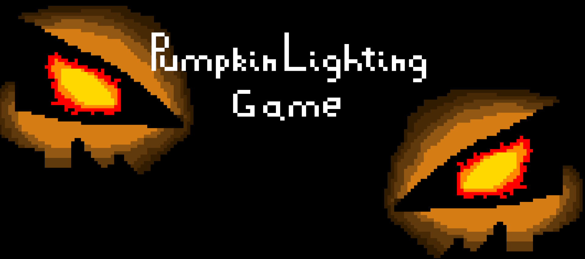

<div align="center">



**A 2D pixel-art card game of shared effects and careful counterplay, played against an AI opponent.**

Designed, programmed and drawn entirely by hand, solo, in Unity.

[](https://typevoidgames.itch.io/pumpkin-lighting-game)


</div>

---

## Table of Contents

- [About the Game](#about-the-game)
- [How to Play](#how-to-play)
- [Technical Overview](#technical-overview)
- [Technical Challenges and Solutions](#technical-challenges-and-solutions)
- [What I Learned](#what-i-learned)
- [Running the Project](#running-the-project)
- [Credits](#credits)
- [Licence](#licence)

---

## About the Game

Pumpkin Lighting Game is a short, tactical card game for one player against an AI opponent. Each round, both players light pumpkins whose effects (such as -2 health or +1 card) apply to **both** of them, and then play cards that bend those effects in their own favour. Because every pumpkin hits both sides, the board is often evenly balanced, and the game is about manipulating that even position into an advantage: block an effect for yourself, invert one for your opponent, double a damaging pumpkin you know they cannot defend against.


It is a best-of-five match with a handful of rules and a lot of room to out-think the opponent. The game began life as a terminal game written in Java. A first attempt to port it to Unity during a game jam failed, and this version is the rebuild from scratch. It was the first non-tutorial game I built in Unity, and it was made solo over six afternoons, with all code, pixel art and even the font created by hand.

## How to Play

### Match structure

- A match is a **best of five** rounds. The first player to reach **3 points** wins.
- In every round, both players start with **5 lives**.
- The player who goes first **swaps each round**.
- A round is made of one or more **cycles**. There is no limit on how many cycles a round can last, and a round ends when a player runs out of lives.
- If both players are knocked out in the same cycle, the round is a **draw** and both players get a point. If neither player can reach 3 points exclusively, the match itself can end in a draw.

### A cycle

1. **Player 1** lights a pumpkin.
2. **Player 2** lights a pumpkin and plays a card.
3. **Player 1** plays a card.
4. Once everything has been selected, the game **resolves the cycle automatically**: the pumpkin effects are applied to both players, modified by the cards that were played.
5. Each player draws one card from their **40-card deck**. Players begin each round holding 5 cards.

Everything is played with the mouse. Click a pumpkin to light it and click a card to play it.


### Pumpkin effects

Every pumpkin carries an effect that applies to both players. The effects assigned to the pumpkins are randomised every round, and the effect pool grows as the match progresses:

| Available from | Effects |
| --- | --- |
| Round 1 | Half Health, -2 Health, +2 Health, Null Cards, +1 Card, -1 Card |
| Round 2 | -2 Cards |
| Round 3 | -3 Health |
| Round 4 | Clear Hand |
| Round 5 | Instant Death |

Since effects hit both players, they often cancel out on paper. The skill lies in using cards to break the symmetry.

### Cards

| Card | Effect |
| --- | --- |
| **Block effect for self** (*Healthy Bone*) | Protects you from the pumpkin effects this cycle |
| **Block effect for opponent** (*Bad Bone*) | Stops the pumpkin effects from applying to your opponent |
| **Invert pumpkin effects** | Reverses the pumpkin effects (damage becomes healing, and the other way round). Inverting *Clear Hand* gives you 5 cards instead of removing your hand |
| **Halve pumpkin effects** | Halves the strength of the pumpkin effects |
| **Double pumpkin effects** | Doubles the strength of the pumpkin effects |

The **Null Cards** pumpkin cancels every card played in that cycle, which makes it a strong tool for leaving an opponent unable to defend against another pumpkin's effect.


## Technical Overview

| | |
| --- | --- |
| **Engine** | Unity 6 (2D) |
| **Language** | C# |
| **Platform** | Windows |
| **Art** | Hand-drawn pixel art and pixel font, made in Piskel |
| **Animation** | Unity Animator |
| **Opponent** | Random-choice AI |
| **Team** | Solo project |
| **Development time** | 6 afternoons |

### Architecture

The game is structured around a **central game controller** that owns the match flow: turn order, pumpkin and card selection, effect resolution, drawing from the deck, scoring and round transitions. It also owns the lists of pumpkin and card behaviours, and distributes them to the pumpkins and cards it spawns.

### The AI opponent

The opponent chooses its pumpkins and cards at random from its legal options. It is intentionally simple, and the game is still challenging because of how strongly randomised pumpkin effects and card draws shape each round.

## Technical Challenges and Solutions

### Combining effects at scale

**Challenge.** The core of the game is working out the final effect on each player from several overlapping inputs: the lit pumpkins, the cards played by both players, and the cards that modify other cards. With up to ten pumpkin effects and five card types, the number of combinations grows quickly. My first implementation used switch statements to handle each case, and it became a scaling nightmare: every new effect or card meant revisiting and extending the branching logic, and the risk of missing a combination grew with each addition.

**Solution.** I replaced the branching logic with **behaviour as data**. Each pumpkin effect and each card manipulation is defined as a **lambda function** (`Func<double, double>`). The game controller stores them in lists and hands them out to the pumpkins and cards it creates. Cards transform a strength multiplier, and each pumpkin's lambda turns that multiplier into its final numeric effect:

```csharp
// Pumpkin effects unlock as the match progresses, each carrying its own lambda
public void AddPumpkins(int currentTurn)
{
    if (currentTurn == 3)
    {
        pumpkinMessages.Add("-3health");
        pumpkinApplications.Add((t) => -3 * t);
    }
    if (currentTurn == 5)
    {
        pumpkinMessages.Add("Instantdeath");
        pumpkinApplications.Add((t) => -100 * t);
    }
    // ...
}

// Card modifiers: each one transforms the strength of the pumpkin effects
List<Func<double, double>> applications = new List<Func<double, double>>
{
    (t) => t,        // pass-through
    (t) => t,        // pass-through
    (t) => 2 * t,    // double
    (t) => 0.5 * t,  // halve
    (t) => -t        // invert
};
```

Resolution runs once per player. The player's card and then the opponent's card are applied to a starting multiplier of 1.0, the pumpkin's own lambda converts that into a numeric effect, and the result is applied to the player's health or hand:

```csharp
public int ApplyEffects(int playerHealth, Card card, Card otherCard, Player player, bool nullified)
{
    if (effect == "Nullcards") return playerHealth;
    if (card.GetCardName() == "Healthy Bone" && !nullified) return playerHealth;   // blocked for self
    if (otherCard.GetCardName() == "Bad Bone" && !nullified) return playerHealth;  // blocked by opponent

    double mul = 1.0;
    if (!nullified) mul = otherCard.Apply(card.Apply(mul));  // compose the card modifiers
    double numEffect = application(mul);                     // pumpkin's own lambda

    switch (effect)
    {
        case "Halfhealth": return (int)(playerHealth * numEffect);
        case "+1card":     AddOrTakeCard(player, numEffect);  return playerHealth;
        case "-1card":     AddOrTakeCard(player, -numEffect); return playerHealth;
        // ...
        case "Clearhand":
            if (mul >= 0.0) player.ClearCards();         // normal Clear Hand
            if (mul < 0.0)  player.IncreaseCardsOwed(5); // inverted: grants cards instead
            return playerHealth;
        default: return playerHealth + (int)numEffect;
    }
}
```

The combinations that exploded the original switch (every card stacked with every pumpkin) are now handled by composition, so the chain of function calls is assembled at runtime from whatever was played. The only remaining switch dispatches on the *kind* of effect (health or cards), not on combinations. Adding a new pumpkin or card now means writing one lambda and adding it to a list, with no changes to the resolution logic. Edge cases fall out naturally too: an inverted Instant Death heals, and an inverted Clear Hand gives cards. It made the game far easier to extend, and it was a satisfying use of functional programming within C#.

## What I Learned

**How to structure a Unity project.** This was the first game I made in Unity that was not a tutorial, and the biggest thing I took from it was how to actually structure a project, both in code and in the scene hierarchy. The game started as a terminal game in Java, and during a game jam we tried to port it into Unity. Our unfamiliarity with the engine meant the project broke beyond repair and we had no idea how to fix it. Rebuilding it from the ground up on my own taught me how to organise scenes, objects and scripts so that the project stays understandable and fixable.

**Animation with the Animator.** I learned how to create animations in the editor using Unity's Animator tool, which I used to bring the pixel art to life. The method I used is outdated compared to what I use now, but it gave me a solid base to build on.

**Treating behaviour as data.** Replacing the switch statements with lambdas showed me how much cleaner a system becomes when behaviours can be stored, passed around and composed. It is a technique I now reach for whenever I see a growing pile of conditional logic.

**What I would do differently.** The game is built around a central controller that manually drives everything in an imperative, step-by-step process. Nowadays I use a more asynchronous structure based on **event channels**, which fully uses the observer pattern. If I rebuilt the game, each component would define its own local behaviour in response to observed state changes instead of being told what to do. That approach is easier to maintain and scale, easier to reason about, and more decoupled, which makes debugging simpler. I would also build a smarter AI that reasons about the outcome of its choices instead of picking at random, although I find the game can already be hard to win at times.

**What I am proudest of.** The animations, and the robustness of the system as a whole for my ability at the time. Even edge cases such as inverted effects, nullified cards and blocked pumpkins behave consistently because they all pass through the same composable pipeline.

**Doing everything myself.** Designing the rules, writing every line of code, and drawing every sprite and even the pixel font by hand in Piskel gave me a full view of how a small game fits together, and a real appreciation of how much work is hidden in even a simple project.

## Running the Project

**Play the game:** download the Windows build from [itch.io](https://typevoidgames.itch.io/pumpkin-lighting-game)

**Open the project:**

1. Install Unity 6 through Unity Hub (the project was originally created with an earlier Unity 6 release and has since been upgraded).
2. Clone this repository: `git clone https://github.com/MateuszGolebiewski591/Pumpkin-Lighting-Game-2D`
3. Add the project in Unity Hub and open it.

## Credits

Created by **[Mateusz Golebiewski](https://github.com/MateuszGolebiewski591)** (TypeVoidGames). All code and artwork is original and was made by hand, with the pixel art and the pixel font drawn letter by letter in [Piskel](https://www.piskelapp.com/).

## Licence

This project has no formal licence. It is entirely self-made and completely open source.
